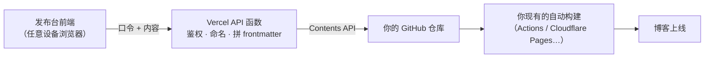

# firefly-publisher

**给静态博客装一个"随时随地发文"的发布台**——纯静态前端 + Vercel 无框架函数，口令登录，发文 / 改稿 / 删除 / 预览全在浏览器完成，最终自动提交回你的 GitHub 仓库触发构建上线。默认适配 [Firefly](https://github.com/CuteLeaf/Firefly) 博客约定，**路径和文件命名全部可用环境变量改**，其他静态博客也能用。

> **English summary:** A self-hosted publishing console for static blogs. Static frontend + 5 Vercel serverless functions, passphrase login, write / edit / delete / preview from any browser, commits back to your GitHub repo to trigger your existing build. Defaults follow the Firefly blog conventions; every path and filename template is overridable via environment variables. Quick start: create a fine-grained PAT (Contents: read/write) → deploy this repo to Vercel → set `GITHUB_REPO` / `PUBLISH_TOKEN` / `GITHUB_TOKEN` → open your URL and log in. Full steps and the five real-world deployment pitfalls are documented below (Chinese).

## 界面预览

| 发布 | 管理 |
|---|---|
|  |  |

## 特性

- **登录门**：口令存环境变量，每次打开发布台都要登录（sessionStorage，关浏览器失效）
- **三类内容**：文章 / 更新公告 / 动态，文件名自动生成（序号顺延、日期时间戳、冲突自动加 `-2`）
- **自动 frontmatter**：18 项可选字段按常见文章 schema 排列，**留空不写**，和手写文件完全同构
- **内容管理**：列表（草稿/置顶徽章）→ 编辑全文 → marked 本地预览 → 保存 / 删除
- **并发安全**：读写带 Git sha，冲突返回 409 而不是互相覆盖
- **路径白名单**：只允许操作配置目录下的 `.md/.mdx`，删不掉别的文件
- **零构建**：前端就是一个 HTML + 一个 JS，后端是 5 个无框架函数，没有打包步骤

## 架构



博客本体一行架构都不用动——它继续是纯静态站，发布台只是另一个独立部署的小系统，两边靠仓库衔接。

## 快速开始

### 准备：GitHub Token（2 分钟）

1. GitHub → **Settings** → **Developer settings** → **Personal access tokens** → **Fine-grained tokens** → **Generate new token**
2. **Repository access** → Only select repositories → 只勾你的博客仓库
3. **Permissions** → Repository permissions → **Contents** 设为 **Read and write**（其他不动）
4. 生成后**立刻复制**，只显示这一次

再自己想一串发布口令（登录用，如 `firefly-xxxx-xxxx`）。

### 模式 A：独立仓库部署（推荐，不动博客仓库）

1. **Fork 本仓库**，或 Download ZIP 解压
2. Vercel → **Add New Project** → 导入这个仓库（**不需要**改 Root Directory）
3. **Settings → Environment Variables** 添加：

   | Key | Value | 说明 |
   |---|---|---|
   | `GITHUB_REPO` | `你的用户名/博客仓库名` | **必填**，格式 `owner/repo` |
   | `GITHUB_TOKEN` | 刚才的 PAT | 必填 |
   | `PUBLISH_TOKEN` | 你的发布口令 | 必填，登录用 |

4. **Deploy** → 等 **Ready**

### 模式 B：拷贝进已有博客仓库（子目录部署）

1. 把本仓库的全部文件拷进你博客仓库的 `publisher/` 目录（fork 后 `cp -r`，或下载 ZIP 拷贝）
2. Vercel 导入你的博客仓库，**Settings → General → Root Directory** 填 `publisher`
3. 环境变量同上（可选再加 `PUB_*` 覆盖默认路径）
4. **Deploy**

> 本仓库自带 `vercel.json`（锁定输出目录）和 `build` 脚本，模式 B 遇到的"子目录没 build 命令""被仓库根的 vercel.json 串成 `dist`"两个坑已经**预先堵死**，详见下面的踩坑清单。

### 收尾（两种模式相同）

1. **坑：打开部署地址跳到 `vercel.com/login`** → **Settings → Deployment Protection → Vercel Authentication** 关掉（或只保留预览环境保护）；发布台自带口令，页面已加 `noindex`
2. **坑：`*.vercel.app` 国内打不开** → **Settings → Domains → Add Existing** 绑自有子域名，DNS 加 CNAME（建议开 CDN 橙云）；Vercel 报 **Proxy Detected** 警告可无视（对口令保护的个人工具无影响）
3. 打开你的地址 → 登录 → 发一条测试内容 → 确认仓库出现 commit、构建上线

## 环境变量参考

**必填**：`GITHUB_REPO`（`owner/repo`）、`GITHUB_TOKEN`（PAT）、`PUBLISH_TOKEN`（登录口令）

**可选**（默认值 = Firefly 博客约定，改成你自己的）：

| 变量 | 默认值 | 说明 |
|---|---|---|
| `GITHUB_BRANCH` | `master` | 提交目标分支 |
| `PUB_POST_DIR` | `src/content/posts/txt` | 文章目录 |
| `PUB_POST_NAME` | `{n}文章.md` | 文章文件名模板，`{n}` = 自动顺延序号 |
| `PUB_UPDATE_DIR` | `src/content/posts/update` | 更新公告目录 |
| `PUB_UPDATE_NAME` | `更新公告{date}.md` | 公告文件名模板，`{date}` = `YYYYMMDD` |
| `PUB_DYNAMIC_DIR` | `src/content/dynamic` | 动态目录 |
| `PUB_DYNAMIC_NAME` | `{date}-{time}.md` | 动态文件名模板，`{time}` = `HHmm` |
| `PUB_ALLOWED` | `src/content/posts/,src/content/dynamic/` | 允许读/写/删的目录白名单（逗号分隔） |

占位符：`{n}` 序号（只在文件名里出现时启用自动编号扫描）、`{date}` 年月日、`{time}` 时分。英文命名示例：`PUB_POST_NAME=post-{n}.md`、`PUB_DYNAMIC_NAME={date}-{time}.md`。

改了环境变量在 Vercel 里 **Redeploy** 一次才生效。

## 两个踩坑清单（我们真实踩过的）

| 症状 | 原因 | 解法 |
|---|---|---|
| `Command "build" not found` | 子目录 `package.json` 没有 build 脚本（模式 B） | 本仓库已带 `"build"` 脚本 |
| `No Output Directory named "dist"` | **博客仓库根的 `vercel.json`** 把 `outputDirectory: dist` 串给了子项目，且它优先级高于界面设置 | 本仓库自带子目录 `vercel.json` + build 产出 `dist` 双保险 |
| 打开就跳 `vercel.com/login` | Deployment Protection 默认开着 | 关掉 Vercel Authentication |
| 域名打不开 | `*.vercel.app` 国内 DNS 污染 | 绑自有子域名 + CDN 代理 |
| `Proxy Detected` 警告 | 你的 CDN 代理在 Vercel 前面 | 忽略，功能不受影响 |
| 保存报 409 | 文件在你打开后被改过（本地/别人先提交了） | 刷新重新读取再改，这是保护不是故障 |

## 本地开发与测试

仓库自带**不碰真实仓库**的测试吊床（mock GitHub）：

```bash
node test/local-harness.mjs   # http://127.0.0.1:8788 ，登录口令 test-pass-123
node test/api-test.mjs        # 另开终端，32 项断言
```

吊床用内存数据模拟 GitHub，发布/编辑/删除随便点，重启即重置。

## 安全设计

- 每个请求校验口令（常数时间比较），登录状态只存 sessionStorage
- PAT 用 fine-grained、**单仓库**、**仅 Contents 读写**——泄露的最大损失被锁死
- 路径白名单 + `..` 拒绝 + 仅 `.md/.mdx`，接口删不掉配置目录以外的任何文件
- 保存/删除必须携带文件 sha，防并发覆盖
- 页面 `noindex`，错误信息不回显任何环境变量

## 配套教程

完整的架构讲解与踩坑复盘见博客文章：[Firefly 博客实战：从零搭建任意设备可用的发布台](https://azuma.mstzuomu.space/posts/azuma.zuomu-blog-17/)（中文）。

## License

[MIT](./LICENSE) © jmqsOOOtatoba
